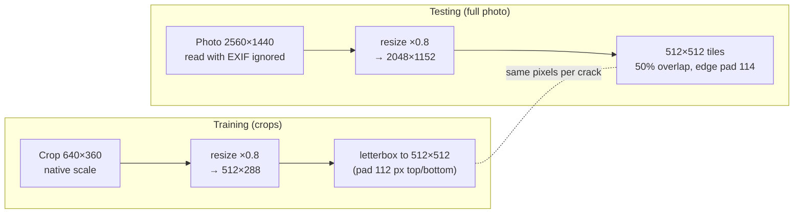
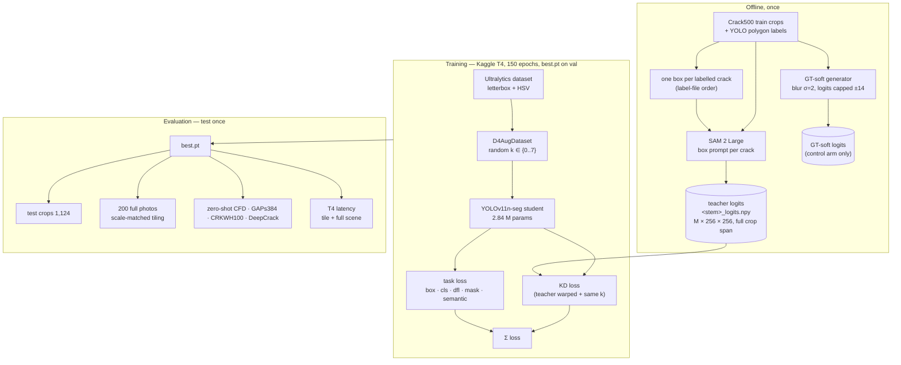
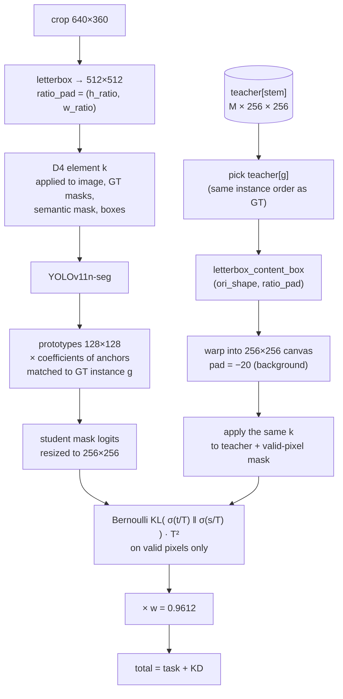
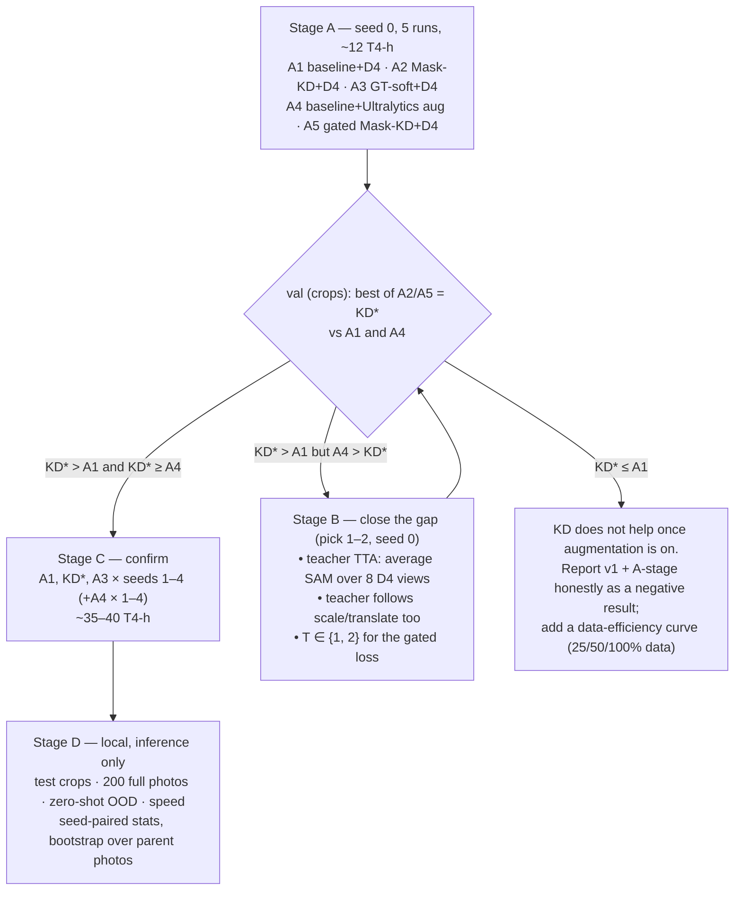

# CrackDistill v2 — how the distillation will work

*2026-10-14. Replaces the training/evaluation protocol in `EXPERIMENTS.md` (v1). The diagrams are Mermaid:
they render on GitHub, in Obsidian and in VS Code's Markdown preview.*

## 1. Decisions at a glance

| Question | Decision | Why (details below) |
| :--- | :--- | :--- |
| Training data | Crack500 **train crops only** (1,896), identical for every arm | Standard benchmark; uncropped train photos are not in the public release; extra data would confound KD vs baseline |
| Test data | (a) the **1,124 canonical test crops**, (b) the **200 full test photos**, (c) **zero-shot** CFD, GAPs384, CRKWH100 (+ DeepCrack as near-OOD) | (a) matches the literature, (b) is the deployment case, (c) is real out-of-distribution |
| Train on crops or full photos? | Crops, at their **native pixel scale** (×0.8 inside the 512 canvas) | Crack widths: median 15–17 px, 10th percentile 3.4 px — downscaling full photos erases the thin ones |
| Test on full photos how? | **Same pixel scale as training**: resize ×0.8, 512×512 tiles, 50% overlap, Gaussian blending, val-tuned threshold | Train/test scale must match; tiling is standard (nnU-Net, SAHI) |
| Augmentation | Every arm: photometric + **D4** (8 flips / 90° rotations); the cached teacher map gets the **same** D4 element | v1 had no spatial augmentation and every arm overfit by epoch 9–17 |
| Distillation signal | Mask-KL to SAM 2 box-prompt logits, two forms: **A2** plain (as v1) and **A5** box-cropped + GT-gated; feature/CWD, boundary, affinity, Tversky dropped | §5.4: the crack is ~1% of the KD canvas and SAM misses 44% of thin-crack pixels; feature KD can't follow augmentation |
| Baselines | **A1** same D4 policy, no KD (the paired baseline) · **A4** Ultralytics default augmentation (mosaic, scale, flips) — the "normal YOLO" reference | KD must beat a strong baseline, not a crippled one |
| Primary metric | Pixel F1 at a val-tuned threshold on the test crops; COCO mask mAP50 secondary | Crack benchmarks are semantic; reviewers expect F1 / IoU / clDice |

## 2. Where we are (v1, seed 0, Kaggle T4, val split)

| Arm (no spatial augmentation) | `best.pt` mask mAP50 | mean epochs 6–25 | mean epochs 26–60 | best epoch |
| :--- | :---: | :---: | :---: | :---: |
| Baseline | 0.410 | 0.376 | 0.331 | 15 |
| Mask-KD | **0.463** | **0.404** | **0.383** | 17 |
| GT-soft control | 0.414 | 0.391 | 0.374 | 9 |

- KD beats both baseline and the soft-label control in every window — promising, one seed.
- **Every arm overfits**: val peaks early while train seg loss falls 3.1 → 0.3. This is the "fixed teacher"
  failure on small data ([Beyer et al. 2022](https://arxiv.org/abs/2106.05237)): a precomputed target that
  does not change with the view.
- The real level of an *augmented* baseline is **unknown**. The old 0.54 came from a baseline that still
  received KD supervision before the September fixes. A4 measures it.

## 3. Data

**Crack500 facts (checked locally):** 250 / 50 / 200 photos. Train exists only as crops: an exact 4×4 grid
(640×360 from 2560×1440, 648×484 from 2592×1936), keeping crops with >1,000 crack pixels. The 1,124 test crops
come from **148** of the 200 test photos; the other 52 (`IMG_*`, mostly 3264×2448) exist only as full photos.
65% of full photos carry an EXIF rotation that their masks do **not** follow.

| Use | Dataset | Notes |
| :--- | :--- | :--- |
| Train / val / test | Crack500 official split | 1,896 / 348 / 1,124 crops; 50 / 200 full photos |
| Zero-shot OOD | [CFD](https://github.com/cuilimeng/CrackForest-dataset) (118, 480×320, asphalt) | Used by FPHBN for cross-dataset tests |
| Zero-shot OOD | GAPs384 (509 test crops, German asphalt) | FPHBN protocol; registration needed |
| Zero-shot OOD | [CRKWH100](https://github.com/qinnzou/DeepCrack) (100, 512×512, asphalt) | Thin labels → use clIoU with 4 px tolerance |
| Near-OOD (local) | DeepCrack test (237, 544×384) | Mixed concrete/stone; never in our training set |
| **Not used** | CrackSeg9k, Khanh11k, OmniCrack30k | Contain Crack500/CFD/DeepCrack images in random splits → test leakage |

**Known limitation:** every training crop contains a crack, so the student never sees bare pavement and will
produce false positives on full photos. The val-tuned threshold partly compensates; report precision on full
photos separately.

## 4. Training at native scale, testing on full photos

The rule: **a crack must be the same number of pixels wide at train and test time.**

Full-photo test recipe:

1. Read raw pixels (`cv2.IMREAD_IGNORE_ORIENTATION`) — the masks follow the raw sensor orientation.
2. Resize by 0.8 (the training scale). The 52 `IMG_*` photos come from other cameras: report them separately.
3. Pad right/bottom with gray 114, cut 512×512 tiles with 50% overlap.
4. Run the student with `conf=0.001` and build a **soft** crack map per tile: for each instance,
   sigmoid(prototype · coefficients), cropped to its box, × its score; combine instances with max.
5. Blend tiles with a 2-D Gaussian weight (centre counts more), crop the padding, resize back to native size.
6. Threshold with τ\* chosen on the 50 full val photos (never on test); compute metrics against the native mask.

The test crops use the same model and the same soft map, without tiling (one crop = one 512 canvas).

## 5. The distillation architecture

### 5.1 System overview

At inference the student runs alone: no SAM 2, no extra parameters.

### 5.2 One training step

**Why D4 and not mosaic/scale:** after letterboxing the canvas is square, so all 8 flips/90° rotations are
exact index permutations of the image, the ¼-resolution masks and the warped teacher alike — no resampling,
no instance can drop out, the teacher-to-instance pairing (`teacher[target_gt_idx]`) is untouched. Mosaic,
scale and translate would need the cached map to be resampled through Ultralytics' affine pipeline and would
drop instances (breaking the pairing). Cracks have no preferred orientation, and rotation was the single most
useful augmentation in a small-crack-dataset ablation ([Wang et al. 2020](https://pmc.ncbi.nlm.nih.gov/articles/PMC7506713/)).

**Verified (tests in `tests/test_d4_augmentation.py`):** boxes follow the pixels for all 8 elements; through
Ultralytics' real training transforms, the warped + rotated teacher lands on the rotated GT (IoU > 0.9) for all
8 elements; a 1-epoch smoke run reached the KD loss with all 8 elements and 0 errors.

### 5.3 Teacher quality (what the student can learn from)

- SAM 2 vs GT on train crops: median IoU **0.605** (the blurred-GT control: 0.796). SAM misses thin
  branches — a known weakness on thin structures ([SAM](https://arxiv.org/abs/2304.02643),
  [WACV 2026](https://arxiv.org/abs/2412.04243)).
- Cache resolution: 256×256 over the whole crop → ~2.5 px per cell horizontally, ~1.4 px vertically.
- GT masks at Ultralytics' ¼ resolution keep 97.5% of crack pixels on Crack500 (measured), so the mask
  resolution is not the bottleneck.

### 5.4 Which KD losses to use

Measured on 578 train instances (teacher at T=1, p > 0.5, native crop resolution):

| Quantity | Value |
| :--- | :--- |
| Crack pixels as a share of the 512×512 KD canvas | median **0.91%** (its GT box: 3.2%) |
| SAM recall of GT crack pixels, by local crack width | ≤4 px **0.56** · 4–8 px 0.66 · 8–16 px 0.75 · >16 px 0.83 |
| SAM crack pixels that are GT background inside the box | median **21%** |
| Images with cached SAM encoder features (for feature KD) | **320 of 2,196** |

| Loss in `kd_trainer.py` | What it does | Evidence | Follows D4? | Decision |
| :--- | :--- | :--- | :---: | :--- |
| **Mask-KL** (plain) | Bernoulli KL to σ(teacher/T) over the whole valid canvas, × T² | v1 seed 0: +0.053 val mAP50 over the no-aug baseline; but ~97% of its pixels are background | yes | **A2** |
| **Mask-KL, box-cropped + GT-gated** (`box_crop`, `gt_gate`) | Same KL, only inside the crack's GT box (normalized by box area, like YOLO's mask loss) and only where SAM agrees with GT | Targets both measured problems; ACE-style gating ([Park & Heo 2020](https://pmc.ncbi.nlm.nih.gov/articles/PMC7471971/)) | yes | **A5** (new) |
| Foreground-dilated KL (`focused`) | Weights SAM foreground 1.0, 8-px band 0.5, rest 0.05 | Fixes background dominance but follows SAM's foreground, including its misses | yes | superseded by A5 |
| Boundary | Soft BCE of the *raw* student vs the *temperature-softened* teacher, weighted where SAM is uncertain | Temperature mismatch teaches blurry crack edges; overlaps the KL; never tested alone | yes | drop |
| Feature / CWD (neck 16·19·22 ← SAM encoder) | Channel-wise KL after 1×1 projectors | Features cached for only 15% of images; P5 target is pooled P4; ViT→CNN gap; gains at YOLO scale +0.8–2.5 mAP with same-family teachers | **no** — SAM features are not rotation-equivariant | drop |
| Pixel affinity | MSE of neighbour differences (2 directions) | v1: lowest in-domain; affinity KD gains vanish vs tuned baselines ([Niemann 2023](https://arxiv.org/abs/2309.03659)) | needs rework | drop |
| Tversky vs teacher | Recall-weighted region loss towards SAM's mask | Pulls towards SAM's misses (recall 0.56 on thin cracks) | yes | drop |
| Multi-scale 512 / resolution-preserving | Match at a finer grid | The teacher is only 256²; upsampling adds no information | yes | drop |

Rule: one KD term, in the plain and the corrected form; nothing is stacked unless the gate in §6 asks for it.

## 6. Experiment plan

| Stage | Runs | T4-hours | Output |
| :--- | :--- | :---: | :--- |
| A | `A1`–`A5`, seed 0 (generated in `final_notebooks/`) | ~12 | which arm wins on val, and which KD loss |
| B (only if needed) | 1–2 loss/teacher variants, seed 0 | ~5 | a KD variant that beats A4 |
| C | winners × seeds 1–4 | ~35–40 | means, CIs, paired tests |
| D | none (local inference) | — | final tables |

**Statistics (Stage C/D):** same seeds in every arm, paired differences with 95% CIs, bootstrap over the 148
parent photos (crops are not independent), Holm correction over KD\* vs A1 and KD\* vs A3, and the minimum
detectable effect. 5 seeds detect ~0.01 if the seed SD is ≤ 0.004.

## 7. What "better than baseline" will be allowed to mean

KD\* = the better of A2 / A5 on val, fixed before Stage C.

| Result | Claim |
| :--- | :--- |
| KD\* > A1, KD\* > A3, KD\* ≥ A4 (CIs exclude 0) | Distilling SAM 2 improves a strongly augmented YOLOv11n-seg, beyond label softening |
| KD\* > A1, KD\* ≈ A3 | The gain is soft-label regularization; SAM is not needed for it |
| KD\* > A1 but A4 > KD\* | KD helps only where geometric augmentation can't be used — a narrower, still honest claim |
| KD\* ≤ A1 | No KD benefit under augmentation; v1's gain was a substitute for augmentation |

## 8. Status

| Piece | State |
| :--- | :--- |
| Letterbox warp, instance pairing, GT-soft control, strict guards | done, tested (v1) |
| D4 augmentation (dataset + teacher + trainer switch `train.d4_aug`) | **done, tested** |
| Box-cropped, GT-gated mask-KL (`mask_kd.box_crop`, `mask_kd.gt_gate`) | **done, tested** (unit + 1-epoch smoke) |
| Stage A notebooks `A1`–`A5` + `B1_benchmark_speed` | **generated** |
| Scale-matched tiling, soft instance maps, pixel F1 / IoU / clDice / clIoU evaluator | to build before Stage D |
| CFD / GAPs384 / CRKWH100 download + conversion | to do before Stage D |
| Teacher TTA, teacher following scale/translate | Stage B, only if the gate needs them |

## 9. Sources

Beyer et al. 2022, *A good teacher is patient and consistent* — [2106.05237](https://arxiv.org/abs/2106.05237) ·
ReLabel — [2101.05022](https://arxiv.org/abs/2101.05022) · FKD — [2112.01528](https://arxiv.org/abs/2112.01528) ·
Niemann et al. 2023 — [2309.03659](https://arxiv.org/abs/2309.03659) · Yuan et al. 2020 (KD ≈ label smoothing) —
[1909.11723](https://arxiv.org/abs/1909.11723) · SVLS — [2104.05788](https://arxiv.org/abs/2104.05788) ·
FPHBN / Crack500 — [1901.06340](https://arxiv.org/abs/1901.06340) · OmniCrack30k —
[CVPRW 2024](https://openaccess.thecvf.com/content/CVPR2024W/VAND/papers/Benz_OmniCrack30k_A_Benchmark_for_Crack_Segmentation_and_the_Reasonable_Effectiveness_CVPRW_2024_paper.pdf) ·
nnU-Net — [1809.10486](https://arxiv.org/abs/1809.10486) · SAHI — [2202.06934](https://arxiv.org/abs/2202.06934) ·
clDice — [2003.07311](https://arxiv.org/abs/2003.07311) · Metrics Reloaded — [2206.01653](https://arxiv.org/abs/2206.01653) ·
Kompanets et al. (patches, negatives) — [2403.17725](https://arxiv.org/abs/2403.17725) ·
Wang et al. 2020 (crack augmentation ablation) — [PMC7506713](https://pmc.ncbi.nlm.nih.gov/articles/PMC7506713/) ·
ACE gating — [PMC7471971](https://pmc.ncbi.nlm.nih.gov/articles/PMC7471971/)
